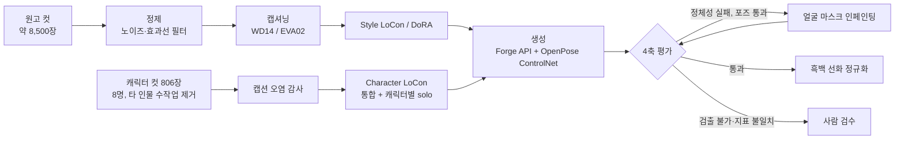

# Webtoon Style LoRA

**웹툰 선화 스타일과 캐릭터 정체성을 재현하는 SDXL LoRA 학습, 4축 정량 평가, 제작 보조 도구**

SDXL LoCon/DoRA로 특정 웹툰 작가의 선화 스타일과 주요 캐릭터 8명을 학습했습니다. 생성 결과를 감으로 고르지 않도록 정체성, 포즈, 스타일, 생산 적합성 네 축으로 나눠 평가하는 파이프라인을 만들었고, 실제 제작자가 버튼만으로 쓸 수 있는 로컬 큐 기반 도구(Studio)로 배포했습니다.

> 학습 데이터, 학습된 가중치, 원작 캐릭터가 등장하는 생성 이미지는 저작권 문제로 공개하지 않습니다. 이 저장소에는 코드, 설정, 실험 기록만 있습니다. 캐릭터 이름은 `char_a` ~ `char_h`로 바꿨습니다.

---

## 문제

현업 웹툰 제작 흐름은 `콘티 → 3D 포즈 → Stable Diffusion + ControlNet 참고 이미지 → 작가 최종 작화`입니다. 세 번째 단계의 결과가 일반적인 애니메이션풍이라 작가가 참고하기 어려웠습니다. 목표는 이 단계의 출력을 **해당 작가의 선화(가는 선, 흰 여백, 절제된 해칭)**와 **정확한 캐릭터 외형**에 가깝게 만드는 것이었습니다.

어려웠던 점:

- 최신 태거로 캡션을 더 자세히 달면 오히려 스타일이 흐려졌습니다.
- 캐릭터 LoRA는 정체성은 맞춰도 포즈를 망가뜨리는 경우가 있었습니다.
- "좋아 보인다"는 판단이 시드 하나, 레퍼런스 하나에 크게 흔들렸습니다.

## 접근



### 1. 스타일과 캐릭터를 분리한 학습

| 모델 | 데이터 | 설정 | 판단 |
|---|---|---|---|
| Style LoCon v2 (WD14 캡션) | 8,514장 | dim 32 / alpha 16, 5 epoch | 클로즈업·액션에서 안정적 |
| Style LoCon v4 (EVA02 캡션) | 8,209장 | conv dim 16, 8 epoch | 태그가 자세해졌지만 v2보다 불안정 |
| Full fine-tuning | 동일 | L40S, 3 epoch | 선이 굵어지고 과적합, 기본안에서 제외 |
| Style DoRA | 동일 | `dora_wd`, Tucker, 1280px | 가는 선·펜 질감 개선 |
| Character LoCon (통합) | 806장, 8명 | 캐릭터별 repeat 5~13으로 균형 | 스타일 LoRA와 조합해 사용 |
| Character LoCon (캐릭터별 solo) | 58~133장 / 캐릭터 | 1024px, batch 4 | 최종 Studio 기본 모델 |

캐릭터 데이터는 사람이 다른 인물을 지운 **정체성 전용 데이터**로 두고, 스타일·구도 학습용 다인물 원본과 섞지 않았습니다. 학습 설정은 [`training/configs`](training/configs)에 있습니다.

### 2. 4축 평가 ([평가 프로토콜](docs/evaluation_protocol.md))

| 축 | 방법 | 비고 |
|---|---|---|
| 캐릭터 정체성 | CCIP 얼굴 임베딩 거리 + 2순위와의 margin | 흑백 선화 도메인에 맞게 임계값 재보정 |
| 속성 보조 | WD EVA02 19개 외형 태그 프로토타입 | CCIP와 불일치하면 사람 검수 |
| 포즈 보존 | DWPose 재검출, coverage + 형태/구도 RMSE | 회전 허용 Procrustes 정렬은 거짓 성공을 만들어 제외 |
| 선화 스타일 | CSD 임베딩 40% + 잉크·여백·에지·선 굵기 분포 60% | CSD 단독으로는 흰 여백을 평가하지 못함 |

종합점수는 후보 정렬에만 쓰고, 자동 합격은 **모든 축의 최소 기준 통과**로 정했습니다.

### 3. 제작 보조 도구: Studio

[`studio/`](studio): 제작자가 대화형 AI 없이 버튼으로 쓰는 Gradio 로컬 앱입니다.

- 캐릭터 여러 명을 고르면 SQLite 기반 직렬 큐로 차례대로 생성하고, 중단 후 재시작해도 복구
- 원본 → B컷(상반신 크롭) → C컷(작은 인물, 얼굴 내부선 생략) 자동 합성
- 인물·생략 마스크를 브러시로 수정하면 GPU 재생성 없이 재합성, 수정 이력 보존
- 모델 10개 SHA256 검증, 외부 서버 주소 입력 거부, 자동 테스트 12개

## 결과

### 정체성 평가 보정

| 항목 | 결과 |
|---|---:|
| 얼굴 크롭 + 오염 데이터 제거 후 원본 self-test | 84% → **90.5%** |
| 레퍼런스 74장 leave-one-out Top-1 | **90.54%** |
| 최적 임계값에서 균형 정확도 | **95.37%** (임계값 0.0634) |
| EVA02 속성 프로토타입 LOO 정확도 | 83.78% (CCIP 대체 불가, 보조로만 사용) |

### 표정과 시드 견고성

8명 × 4표정 대표 시드에서 angry·smile 8/8, neutral·sad 7/8로 정체성을 유지했습니다. 강한 표정은 시드에 따라 흔들려서, 실측 통과율로 **"95% 확률로 1장 확보에 필요한 생성 수 N"**을 계산해 운영 기준으로 삼았습니다. 단일 시드에서 좋아 보인 프롬프트 수정이 4시드 평균에서는 75% → 50%로 오히려 나빠진 반례도 기록했습니다.

### 조건부 얼굴 보정

| 사례 | CCIP 판정 | CCIP 거리 | 포즈 점수 |
|---|---|---:|---:|
| 보정 전 | 다른 캐릭터로 오인 | 0.0733 | 0.7332 |
| 얼굴 인페인팅 (denoise 0.52) | **목표 캐릭터** | **0.0429** | 0.7367 |

포즈는 지키면서 정체성만 되돌렸습니다. 포즈가 통과한 후보에만 보정을 적용합니다.

### Studio 검증

8명 전체를 한 번에 등록해 8개 작업, B/C컷 16장이 모두 검수 대기까지 완료됐습니다. RTX 5070 12GB, Forge Neo 기준입니다.

더 자세한 실험은 [실험 기록](docs/experiments.md)에 있습니다.

## 실패와 판단

연구에서 가장 중요하게 생각한 부분입니다.

- **더 좋은 태거 ≠ 더 좋은 스타일 LoRA.** EVA02 캡션(v4)이 WD14(v2)보다 불안정했습니다. 작가의 펜 질감은 Danbooru 태그로 표현되지 않으므로, 분리 가능한 내용(인물·구도)만 캡션으로 빼고 질감은 트리거가 흡수하게 했습니다.
- **정체성이 맞아도 포즈가 틀리면 실패.** 초기 선택기는 CCIP 최저값만 봐서 포즈가 틀린 후보를 자동 성공으로 골랐습니다. 두 게이트를 분리했습니다.
- **포즈 지표의 거짓 성공 제거.** 회전까지 허용하는 정렬은 옆으로 돌아간 결과를 보상해서 0.566이던 실패 사례 점수가 기준을 넘었습니다. 회전을 빼자 0.422로 내려가 올바르게 실패 처리됐습니다.
- **입력 포즈부터 검사.** 무릎 꿇기·환호 포즈는 검출 관절이 3개, 0개라 실험 자체가 무효였습니다. 이후 8관절 미만 입력은 생성 전에 차단합니다.
- **상관이 없으면 인과를 주장하지 않음.** 캡션 감사에서 한 캐릭터의 43.5%에 성별·수염 모순 태그가 있었지만, 오염률과 생성 통과율의 상관은 관찰되지 않았습니다(Spearman ρ=0.00). 원인으로 단정하지 않고, 총 step을 맞춘 정제 전후 A/B 재학습 계획으로 넘겼습니다.
- **style LoRA 하나로는 군중이 안 됨.** 6명을 지정해도 수십 명으로 늘어났고 흰 여백도 실패했습니다(픽셀 SHA256으로 재현성 확인). 공간 조건(ControlNet·영역 박스)과 generic soldier 모델을 분리하는 방향으로 정했습니다.
- **손 ADetailer는 흑백 선화 손을 검출하지 못함.** confidence 0.10까지 낮춰도 출력 변화가 0픽셀이라 기본 단계에서 뺐습니다.

## 한계와 다음 단계

- 생성 도메인 CCIP 임계값(0.09)과 포즈 임계값(0.45)은 임시값입니다. 블라인드 사람 라벨로 재보정이 필요합니다.
- 다인물·군중 장면과 복잡한 러프 스케치를 완성 선화로 바꾸는 문제는 아직 풀지 못했습니다.
- 디퓨전 대신 선의 위치를 보존하면서 잉크 표현만 바꾸는 결정론적 모델은 별도 저장소에서 연구 중입니다.

## 저장소 구조

```
training/
  train_locon.ps1            Kohya LoCon 학습 런처 (Windows)
  configs/                   캐릭터 LoCon 데이터셋·학습 설정 (서버)
  captioning/                WD14, EVA02 캡셔너
  data_cleaning/             원고 전처리, 노이즈·효과선 필터, 캡션 오염 감사
pipeline/
  conditional_face_refine.py 생성 → 4축 평가 → 조건부 얼굴 보정 → 정규화
  multimetric_evaluator.py   정체성·포즈·스타일 통합 평가
  pose_metrics.py            DWPose 기반 포즈 점수
  calibrate_*.py             CCIP·포즈 임계값 보정
  crowd_ab_baseline.py       군중 생성 단일 변수 A/B
  ...
studio/                      Gradio 제작 보조 앱 + 테스트
docs/                        평가 프로토콜, 실험 기록
```

## 환경

- 베이스 모델: waiIllustrious SDXL v1.6
- 학습: Kohya sd-scripts + LyCORIS, NVIDIA L40S 46GB
- 추론·평가: Forge Neo API, RTX 5070 12GB
- 평가: [dghs-imgutils (CCIP)](https://github.com/deepghs/imgutils), [CSD](https://github.com/learn2phoenix/CSD), DWPose, WD EVA02 Large v3

## 역할

데이터 정제, 캡셔닝 설계, 학습, 평가 지표 설계·보정, 제작 도구 개발까지 전 과정을 수행했습니다. 현업 제작 워크플로의 요구사항과 중간 피드백을 반영했습니다. 구현에는 AI 코딩 도구를 적극 활용했고, 실험 설계와 판단 기준, 결과 해석은 직접 수립했습니다.
