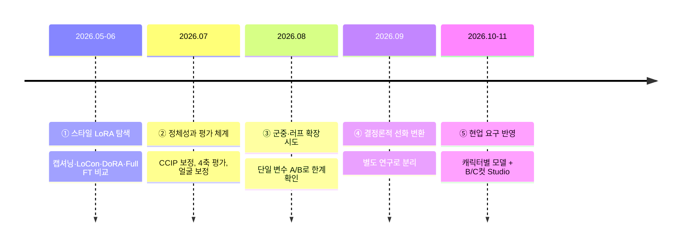
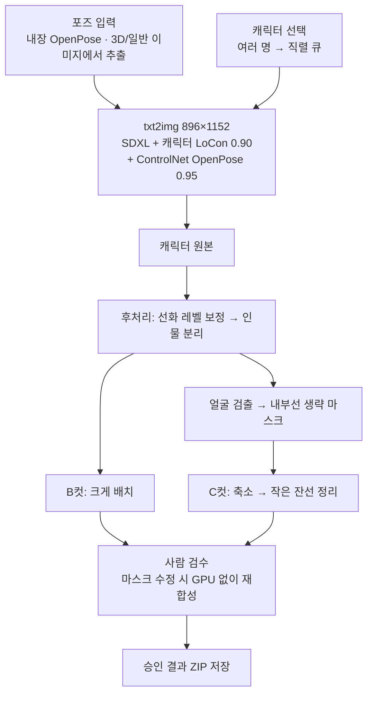

# Webtoon Style LoRA

**웹툰 작가의 선화 스타일과 캐릭터 8명을 SDXL LoRA로 학습하고, 정량 평가 체계와 제작자용 컷 생성 도구까지 만든 연구**

| | |
|---|---|
| 과제 | 웹툰 제작사 산학협력 과제 (연구실 수행, 1인 담당) |
| 기간 | 2026.05 ~ 2026.11 (진행 중) |
| 현재 결과물 | 캐릭터별 LoCon 8개 + B/C컷 생성·검수 도구 **Studio v1.3** (Windows 배포본) |
| 핵심 기술 | SDXL, LyCORIS LoCon/DoRA, Kohya sd-scripts, ControlNet OpenPose, CCIP, CSD, Gradio |
| 환경 | 학습 NVIDIA L40S 46GB / 추론·도구 RTX 5070 12GB |

> 학습 데이터, 가중치, 원작 캐릭터가 나오는 생성 이미지는 저작권 문제로 공개하지 않습니다. 이 저장소에는 코드, 설정, 실험 기록만 있으며 캐릭터 이름은 `char_a` ~ `char_h`로 바꿨습니다.

---

## 왜 시작했나

웹툰 제작사와의 산학협력 과제로 시작했습니다. 현업 제작 흐름은 `콘티 → 3D 포즈 → Stable Diffusion + ControlNet 참고 이미지 → 작가의 최종 작화`입니다. 세 번째 단계의 결과가 일반적인 애니메이션풍이라 작가가 참고하기 어려웠습니다.

목표는 이 단계의 출력을 **해당 작가의 선화(가는 선, 흰 여백, 절제된 해칭)**와 **정확한 캐릭터 외형**에 가깝게 만드는 것이었습니다.

## 연구 흐름



### ① 스타일 LoRA 탐색: "캡션이 자세하다고 스타일이 좋아지지 않는다"

원고 약 8,500컷을 정제해 스타일 LoRA를 학습했습니다.

| 시도 | 관찰 | 판단 |
|---|---|---|
| WD14 캡션 LoCon | 클로즈업·액션에서 안정적 | 기준선 |
| EVA02 캡션 LoCon (더 세밀한 태그) | 내용 태그가 스타일 토큰과 데이터 편향(남성 기사, 갑옷)에 얽혀 오히려 불안정 | 기각 |
| Full fine-tuning | 질감은 강해졌지만 선이 굵어지고 과적합 | 기각 |
| DoRA + 1280px | 가는 선과 펜 질감 개선 | 채택 |

펜 질감은 Danbooru 태그로 표현할 수 없습니다. 그래서 **분리 가능한 속성(인물·구도)만 캡션으로 빼고, 질감은 스타일 트리거가 흡수하도록** 캡셔닝 원칙을 바꿨습니다.

### ② 정체성과 평가 체계: "좋아 보인다를 숫자로"

스타일과 캐릭터 LoRA를 분리하자, 이번에는 결과를 고르는 기준이 문제였습니다. 시드 하나, 레퍼런스 하나에 따라 판단이 흔들렸습니다. 그래서 평가를 네 축으로 나눴습니다 ([평가 프로토콜](docs/evaluation_protocol.md)).

| 축 | 방법 |
|---|---|
| 캐릭터 정체성 | CCIP 얼굴 임베딩 거리 + 2순위와의 margin (흑백 선화에 맞게 임계값 재보정) |
| 포즈 보존 | DWPose 재검출, coverage + 형태·구도 RMSE |
| 선화 스타일 | CSD 임베딩 40% + 잉크·여백·에지·선 굵기 분포 60% |
| 생산 적합성 | 색 누출, 과도한 검정 면적 |

이 단계의 주요 결과입니다. 당시 모델(통합 캐릭터 LoCon + 스타일 DoRA) 기준이며, 현재 Studio 모델로 다시 측정한 값은 아닙니다.

- CCIP 판별: 얼굴 크롭과 오염 데이터 제거로 self-test **84% → 90.5%**, 74장 leave-one-out Top-1 **90.54%**, 균형 정확도 **95.37%**
- **포즈 지표의 거짓 성공 발견**: 회전을 허용하는 정렬이 옆으로 돌아간 결과를 보상해서 실패 사례가 0.566으로 통과하고 있었습니다. 회전을 빼자 0.422로 내려가 올바르게 실패 처리됐습니다.
- **조건부 얼굴 보정**: 포즈는 맞고 정체성만 틀린 후보의 얼굴만 다시 그려, 다른 캐릭터로 오인되던 결과(CCIP 0.0733)를 목표 캐릭터(0.0429)로 되돌렸습니다. 포즈 점수는 유지됐습니다(0.733 → 0.737).
- **시드 견고성**: 강한 표정은 통과율 50~75%였습니다. 프롬프트를 약하게 만드는 대신 "95% 확률로 1장 확보에 필요한 생성 수"를 계산해 운영 기준으로 삼았습니다.
- **상관이 없으면 인과를 말하지 않음**: 한 캐릭터의 캡션 43.5%에 성별·수염 모순 태그가 있었지만, 오염률과 생성 통과율의 상관은 없었습니다(Spearman ρ=0.00). 그래서 원인으로 단정하지 않고, 총 step을 맞춘 정제 전후 A/B 재학습을 설계했습니다.

### ③ 군중·러프 확장 시도: "LoRA 가중치 하나로는 안 된다"

현업 중간 점검 뒤 요구가 이름 없는 병사·군중과 복잡한 러프 스케치 변환으로 넓어졌습니다. 다른 조건을 모두 고정하고 style LoRA weight만 바꾼 A/B에서는, 6명을 지정해도 수십 명으로 늘어났고 흰 여백도 실패했습니다. 재실행 결과는 픽셀 SHA256까지 같아 재현성을 확인했습니다.

판단: 인원수와 배치는 LoRA가 아니라 **공간 조건(ControlNet, 영역 박스)으로 풀 문제**입니다. 러프 변환은 paired 데이터가 필요한 별도 과제로 분리했습니다.

### ④ 결정론적 선화 변환: 별도 연구

img2img로 다른 선화에 스타일을 입히면 denoise를 높일수록 얼굴과 의상 구조가 바뀌었습니다. 선의 위치는 그대로 두고 잉크 표현만 바꾸는 픽셀 공간 모델을 따로 연구하고 있습니다 (별도 저장소 예정).

### ⑤ 현업 요구 반영: 캐릭터별 모델 + B/C컷 Studio

현업과 논의하며 당장 쓸 수 있는 과제를 **개별 캐릭터의 B/C컷 생성**으로 좁혔습니다.

- **B컷**: 인물이 크게 들어가 상반신 위주로 보이는 컷
- **C컷**: 인물이 작게 들어가는 원거리 전신 컷. 머리·체격·장비 실루엣은 남기고 눈·코·입 같은 작은 내부선은 줄입니다.

같은 캐릭터라도 **컷 안에서 차지하는 크기에 따라 필요한 디테일이 다르다**는 것이 핵심입니다.

- 8명을 함께 학습한 통합 모델과 캐릭터별 개별 모델을 같은 추론 조건에서 비교했고, 제작 쪽 정성 평가에서 개별 모델이 선택됐습니다. 학습 데이터가 완전히 같지는 않아서 엄밀한 학습 ablation이 아니라 추론 조건을 통제한 비교로만 기록했습니다.
- 이 단계에서는 별도 스타일 LoRA를 쓰지 않고 캐릭터 LoCon 하나(강도 0.90)만 씁니다.
- 제작자가 대화형 AI 없이 버튼으로 쓰도록 Gradio 로컬 도구로 만들어 Windows 배포본을 전달했습니다.

## 현재 시스템



- C컷의 얼굴 내부선 생략과 잔선 정리는 **모델 성능이 아니라 후처리**입니다.
- 3D 렌더 입력은 OpenPose 골격만 추출해 쓰는 txt2img입니다. 원본 픽셀을 이어받는 img2img가 아니라서, 3D의 의상 디테일이나 손가락까지 보존하지는 않습니다.
- 자동 테스트 12개가 큐 복구·취소, 마스크 저장값, 분리 실패 복구, 얼굴 검출 실패 경고, ZIP 내용 등 프로그램 동작을 검사합니다. 작화 품질 점수는 아닙니다.
- 실제 검증: RTX 5070 12GB에서 8명 일괄 등록 → B/C컷 16장 생성·검수까지 완료.

자세한 내용은 [Studio 문서](studio/README.md)와 [실험 기록](docs/experiments.md)에 있습니다.

## 실패에서 얻은 원칙

| 실패 | 바꾼 원칙 |
|---|---|
| 더 좋은 태거로 캡션을 바꾸자 스타일이 불안정해짐 | 질감은 트리거에, 분리 가능한 속성만 캡션에 |
| CCIP 최저값만 보는 선택기가 포즈가 틀린 후보를 성공으로 고름 | 정체성과 포즈를 별도 게이트로 분리 |
| 회전 허용 정렬이 실패한 포즈를 통과시킴 | 지표 자체를 검증하고, 거짓 성공을 찾으면 지표를 고침 |
| 무릎 꿇기 포즈 입력에서 관절이 3개만 검출돼 실험 전체가 무효 | 입력 품질을 생성 전에 검사 (8관절 미만 차단) |
| 단일 시드에서 좋아 보인 프롬프트 수정이 4시드 평균에서는 악화 | 단일 시드 결과로 결론 내리지 않음 |
| 흑백 선화의 손을 ADetailer가 검출하지 못함 (출력 변화 0픽셀) | 동작을 확인하지 않은 도구는 기본 단계에서 제외 |

## 한계와 다음 단계

- 현재 Studio 모델(캐릭터별 LoCon)에 대한 정량 평가는 아직 다시 하지 않았습니다. ② 단계의 평가 체계를 같은 포즈·시드 세트로 다시 적용하는 것이 다음 과제입니다.
- 손가락, 무기 쥐기, 장비 일관성, 원본 가장자리 잘림은 사람 검수에 의존합니다.
- 다인물 상호작용, 군중, 복잡한 러프 → 완성 선화 변환은 아직 풀지 못했습니다.
- 학습 당시 데이터와 현재 정제 폴더 사이에 차이가 있어(806장 → 792장), 재학습 전에 데이터 버전을 고정해야 합니다.
- 다른 PC에서의 새 설치와 다른 GPU 호환성은 아직 검증하지 않았습니다.

## 저장소 구조

```
training/
  train_locon.ps1          Kohya LoCon 학습 런처 (Windows)
  configs/                 캐릭터 LoCon 데이터셋·학습 설정
  captioning/              WD14, EVA02 캡셔너
  data_cleaning/           원고 전처리, 노이즈·효과선 필터, 캡션 오염 감사
pipeline/                  ②·③ 단계: 4축 평가, 임계값 보정, 조건부 얼굴 보정, 군중 A/B
studio/                    ⑤ 단계: B/C컷 생성·검수 도구와 테스트
docs/
  evaluation_protocol.md   4축 평가 기준
  experiments.md           단계별 실험 기록과 수치
```

## 역할

산학협력 과제를 혼자 맡아 데이터 정제, 캡셔닝 설계, 학습, 평가 지표 설계·보정, 제작 도구 개발과 납품까지 전 과정을 수행했고, 제작사의 요구와 중간 피드백을 반영했습니다. 구현에는 AI 코딩 도구를 적극 활용했고, 실험 설계·판단 기준·결과 해석은 직접 수립했습니다.
